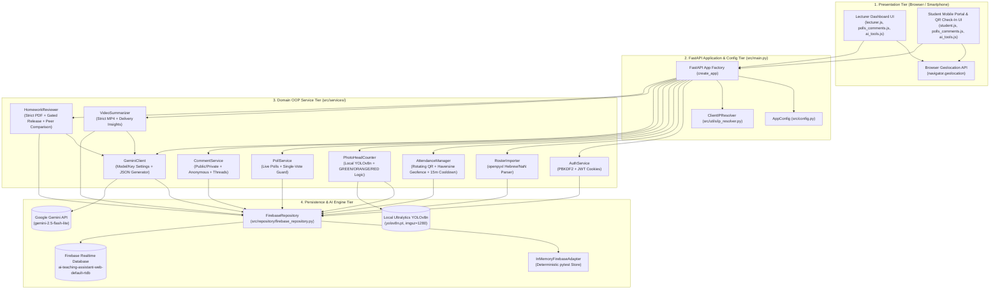
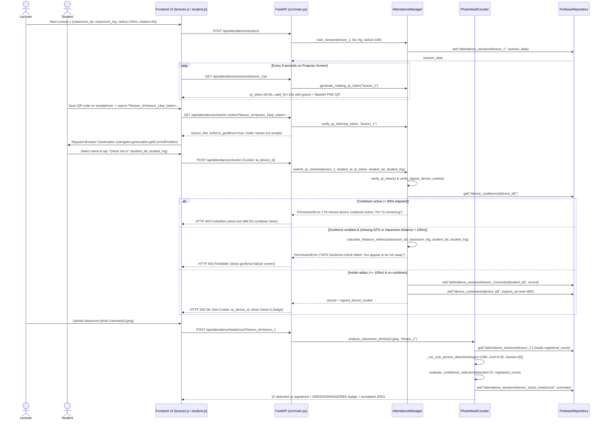
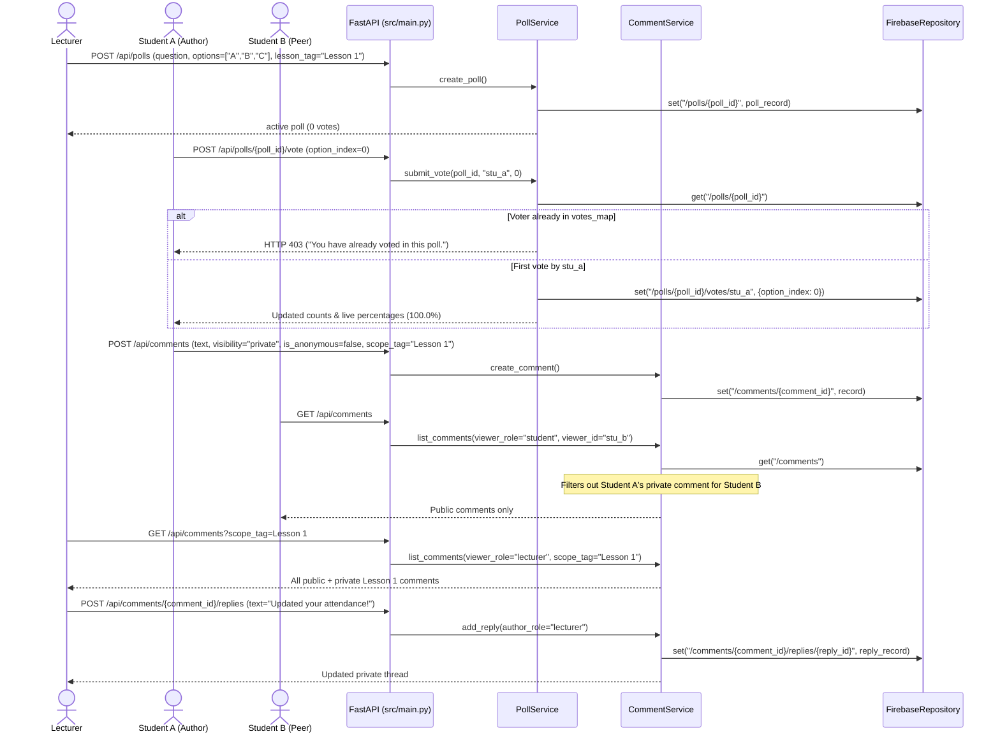
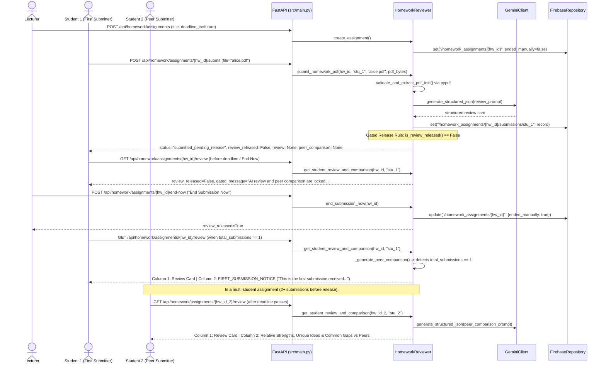

# Software Architecture, Low-Level Class Diagram & Sequence Diagrams

> **Project:** Web-Based AI Teaching Assistant (Ex2: Vibe Coding & Deep Designing)  
> **Team:** Ilay (`IlayOr-Chen`) & Roie (`RoieBenyamin`)

---

## 1. Architectural Overview & Main Software Components

The system follows a clean 4-tier **Object-Oriented Architecture (KISS + Deep OOD)** separating presentation, HTTP routing, domain business logic, and data/AI persistence:

1. **Presentation Tier (`src/static/`):** Responsive, mobile-first Vanilla HTML5/CSS3/ES-Module frontend (`index.html`, `styles.css`, `app.js`, `lecturer.js`, `student.js`, `polls_comments.js`, `ai_tools.js`, `ui.js`, `api.js`, `icons.js`) served directly by FastAPI with zero frontend build tooling overhead.
2. **API Controller & Configuration Tier (`src/main.py`, `src/config.py`, `src/utils/ip_resolver.py`):** FastAPI application factory (`create_app`) wiring Pydantic request schemas, HTTP-only JWT/device cookies, `AppConfig`, and proxy-aware `ClientIPResolver`.
3. **Domain OOP Service Tier (`src/services/`):** Nine cohesive domain service classes (`AuthService`, `RosterImporter`, `AttendanceManager`, `PhotoHeadCounter`, `PollService`, `CommentService`, `GeminiClient`, `VideoSummarizer`, `HomeworkReviewer`) encapsulating all validation, cryptography, Haversine GPS math, YOLO headcounting, and gated homework release rules.
4. **Persistence & AI Infrastructure Tier (`src/repository/firebase_repository.py`):** `FirebaseRepository` abstracting live **Firebase Realtime Database (RTDB)** operations alongside `InMemoryFirebaseAdapter` for deterministic `pytest` execution.

---

## 2. Low-Level Class Diagram (100% Matched to `src/`)

Every class, attribute, method, and relationship below corresponds 1-to-1 with the Python classes in `src/` and is continuously verified by `tests/test_architecture_and_edge_cases.py`:

```mermaid
classDiagram
    class AppConfig {
        +str firebase_db_url
        +str firebase_credentials_path
        +bool use_mock_firebase
        +str jwt_secret
        +str jwt_algorithm
        +int jwt_expiration_hours
        +str lecturer_access_code
        +int qr_rotation_seconds
        +int qr_grace_seconds
        +int device_cooldown_minutes
        +bool enforce_geofence_default
        +int geofence_radius_meters
        +str gemini_api_key
        +str gemini_model
        +str yolo_model_path
        +float yolo_confidence_threshold
        +str public_base_url
        +from_env(env_file)$ AppConfig
    }

    class InMemoryFirebaseAdapter {
        -RLock _lock
        -dict _store
        -int _push_counter
        +normalize_path(path)$ list~str~
        +get(path) Any
        +set(path, value) Any
        +update(path, updates) dict
        +push(path, value) str
        +delete(path) bool
        +clear() None
    }

    class FirebaseRepository {
        +str db_url
        +str credentials_path
        +bool use_mock
        +float http_timeout
        -InMemoryFirebaseAdapter _mock
        -Any _admin_db
        -_try_init_firebase_admin() None
        -_build_rest_url(path) str
        +get(path) Any
        +set(path, value) Any
        +update(path, updates) dict
        +push(path, value) str
        +delete(path) bool
        +reset_mock() None
    }

    class ClientIPResolver {
        +resolve_from_headers(headers, fallback_host)$ tuple~str,str~
        +is_loopback_or_private(ip_address)$ bool
        +resolve(request)$ str
        +resolve_with_source(request)$ dict~str,str~
    }

    class AuthService {
        +FirebaseRepository repository
        +AppConfig config
        +email_to_key(email)$ str
        +hash_password(password, salt)$ str
        +verify_password(password, stored_hash)$ bool
        +create_jwt_token(subject_id, role, email, full_name, extra_claims, expires_in_seconds) str
        +verify_jwt_token(token, required_role) dict
        +seed_default_lecturer() dict
        +register_lecturer(full_name, email, password, access_code) dict
        +login_lecturer(email, password) dict
        +authenticate_student(student_id, email, full_name) dict
        +extract_token_from_request(request, prefer_role) str
        +require_lecturer_claims(request) dict
    }

    class RosterImporter {
        +FirebaseRepository repository
        +email_to_student_id(email)$ str
        +normalize_group(raw_group)$ str
        -_resolve_column_indices(header_row)$ dict
        +parse_excel_rows(source) tuple~list,int~
        +import_from_excel(source, replace_existing) dict
        +ensure_roster_seeded(default_asset_path) dict
        +list_students(search_query, group_filter) list~dict~
        +get_student(student_id) dict
    }

    class AttendanceManager {
        +FirebaseRepository repository
        +AppConfig config
        +calculate_distance_meters(lat1, lon1, lat2, lon2)$ float
        -_validate_optional_coords(lat, lng)$ tuple
        +create_signed_device_cookie(device_id) tuple~str,str~
        +verify_signed_device_cookie(cookie_value) str
        +start_session(lesson_id, lesson_title, classroom_lat, classroom_lng, geofence_radius_meters, enforce_geofence, rotation_seconds) dict
        +close_session(lesson_id) dict
        +set_geofence_enforcement(lesson_id, enforce_geofence, geofence_radius_meters, classroom_lat, classroom_lng) dict
        +get_session(lesson_id) dict
        +list_sessions() list~dict~
        -_render_qr_data_url(target_url)$ str
        +generate_rotating_qr_token(lesson_id, base_url, ttl_override_seconds, now_ts) dict
        +verify_qr_token(qr_token, expected_lesson_id) dict
        +check_device_cooldown(device_id, now_ts) dict
        +record_device_cooldown(device_id, student_id, lesson_id, now_ts) dict
        +reset_all_device_cooldowns(now_ts) dict
        +submit_qr_checkin(lesson_id, student_id, qr_token, student_lat, student_lng, device_cookie_value, now_ts) dict
        +set_manual_attendance(lesson_id, student_id, status) dict
        +get_lesson_attendance_report(lesson_id) dict
        -_format_timestamp_iso(unix_ts)$ str
        +export_attendance_csv(lesson_id) bytes
        +export_attendance_xlsx(lesson_id) bytes
    }

    class PhotoHeadCounter {
        +FirebaseRepository repository
        +AppConfig config
        +int imgsz
        -Any _model
        -_get_model() Any
        -_load_pil_image(image_source)$ Image
        +evaluate_confidence_indicator(detected_count, confidences, registered_count)$ dict
        -_annotate_image(pil_image, detections, output_image_path)$ str
        -_run_yolo_person_detection(pil_image, conf_threshold) list~dict~
        +analyze_classroom_photo(image_source, lesson_id, registered_count, conf_threshold, output_image_path) dict
    }

    class PollService {
        +FirebaseRepository repository
        -_format_poll(raw_poll, viewer_id)$ dict
        +create_poll(question, options, lesson_tag, created_by) dict
        +set_poll_active(poll_id, active) dict
        +submit_vote(poll_id, voter_id, option_index) dict
        +get_poll(poll_id, viewer_id) dict
        +list_polls(active_only, viewer_id) list~dict~
    }

    class CommentService {
        +FirebaseRepository repository
        -_sanitize_for_viewer(raw_comment, viewer_role, viewer_id)$ dict
        +create_comment(text, author_id, author_name, author_role, visibility, is_anonymous, scope_tag) dict
        +add_reply(comment_id, text, author_id, author_name, author_role, is_anonymous) dict
        +list_comments(viewer_role, viewer_id, scope_tag) list~dict~
    }

    class GeminiClient {
        +FirebaseRepository repository
        +AppConfig config
        -Callable _transport
        +mask_api_key(api_key)$ str
        +resolve_credentials() tuple~str,str~
        +get_settings() dict
        +update_settings(api_key, model_id) dict
        -_extract_json_dict(raw_text)$ dict
        +generate_structured_json(prompt, fallback_builder, media_bytes, mime_type) dict
    }

    class VideoSummarizer {
        +FirebaseRepository repository
        +GeminiClient gemini_client
        +validate_mp4_upload(filename, video_bytes, content_type)$ str
        -_build_prompt(filename, lesson_tag, lecturer_notes, size_kb)$ str
        +summarize_video(filename, video_bytes, content_type, lesson_tag, lecturer_notes) dict
        +list_summaries() list~dict~
    }

    class HomeworkReviewer {
        +FirebaseRepository repository
        +GeminiClient gemini_client
        +is_review_released(assignment, now_ts)$ bool
        -_extract_docx_text(docx_bytes)$ str
        -_extract_zip_text(zip_bytes, source_label)$ tuple~str,int~
        +validate_and_extract_pdf_text(filename, pdf_bytes, content_type)$ dict
        +extract_public_git_repo_text(repo_url)$ dict
        +create_assignment(title, description, deadline_ts, lesson_tag) dict
        +end_submission_now(assignment_id, now_ts) dict
        -_generate_peer_comparison(assignment, target_submission, all_submissions) dict
        +submit_homework_pdf(assignment_id, student_id, student_name, filename, pdf_bytes, content_type, now_ts, repo_url) dict
        +get_student_review_and_comparison(assignment_id, student_id, viewer_role, now_ts) dict
        -_format_assignment_overview(raw_assignment, viewer_id, now_ts) dict
        +list_assignments(viewer_id, now_ts) list~dict~
    }

    FirebaseRepository *-- InMemoryFirebaseAdapter : delegates when use_mock=True
    AuthService --> FirebaseRepository : reads/writes /users/lecturers & /students
    AuthService --> AppConfig : reads JWT & access code
    RosterImporter --> FirebaseRepository : writes /students
    AttendanceManager --> FirebaseRepository : writes /attendance_sessions & /device_cooldowns
    AttendanceManager --> AppConfig : reads QR & geofence defaults
    PhotoHeadCounter --> FirebaseRepository : writes /attendance_sessions/{id}/yolo_headcount
    PhotoHeadCounter --> AppConfig : reads YOLO weights & threshold
    PollService --> FirebaseRepository : reads/writes /polls
    CommentService --> FirebaseRepository : reads/writes /comments
    GeminiClient --> FirebaseRepository : reads/writes /settings/gemini
    GeminiClient --> AppConfig : reads default key & model
    VideoSummarizer --> GeminiClient : generates MP4 JSON summary
    VideoSummarizer --> FirebaseRepository : writes /video_summaries
    HomeworkReviewer --> GeminiClient : generates PDF review & peer comparison
    HomeworkReviewer --> FirebaseRepository : writes /homework_assignments
```

---

## 3. Sequence Diagrams

### 3.1 Sequence Diagram 1 — Smart Attendance (Rotating QR + Haversine GPS Geofencing + 15-Min Cooldown + Local YOLO Headcount)

### 3.2 Sequence Diagram 2 — On-the-Spot KISS Polls & Threaded Comments (Public/Private & Named/Anonymous)

### 3.3 Sequence Diagram 3 — Gated PDF Homework Review, Peer Comparison & First-Submission Edge Case

